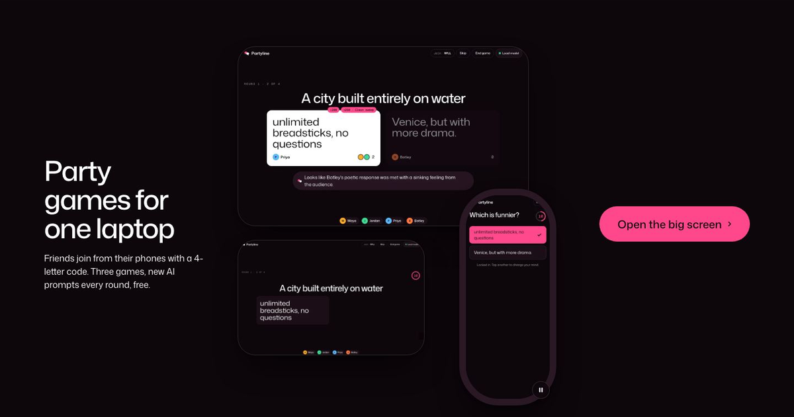
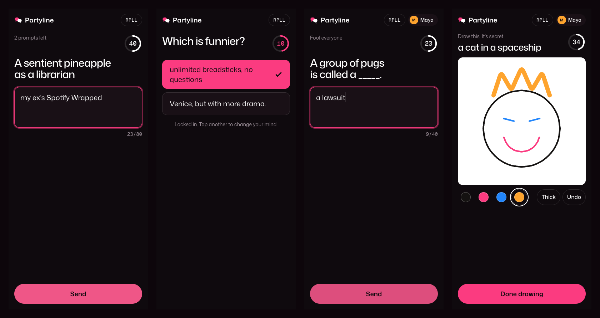
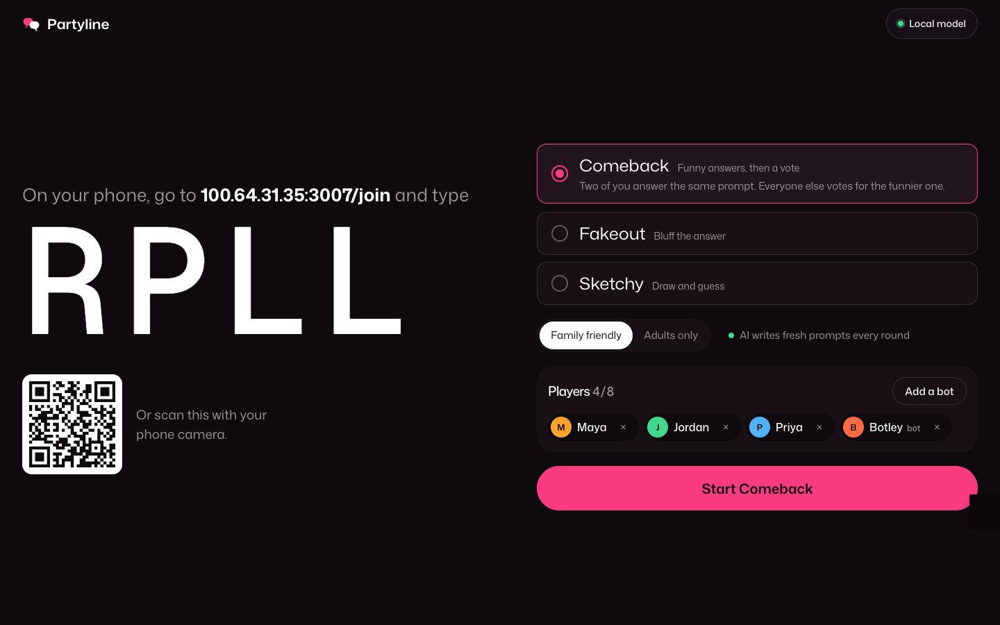
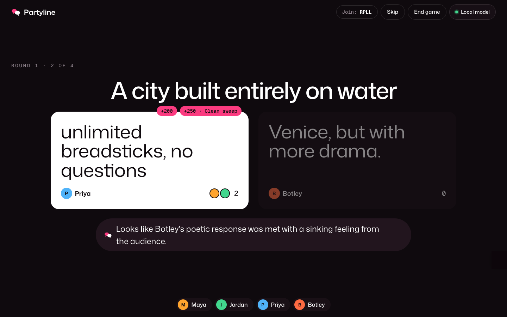
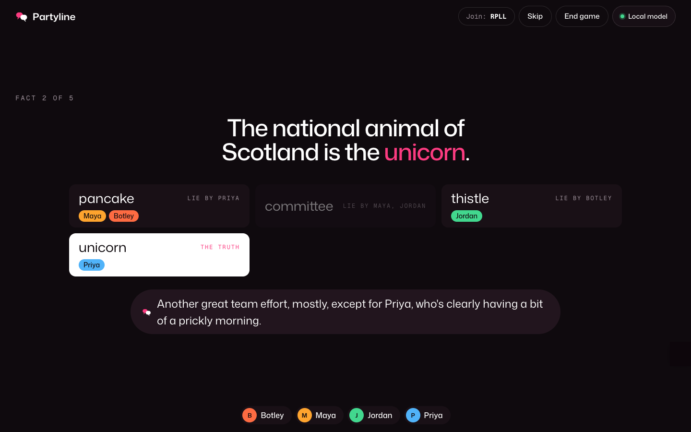
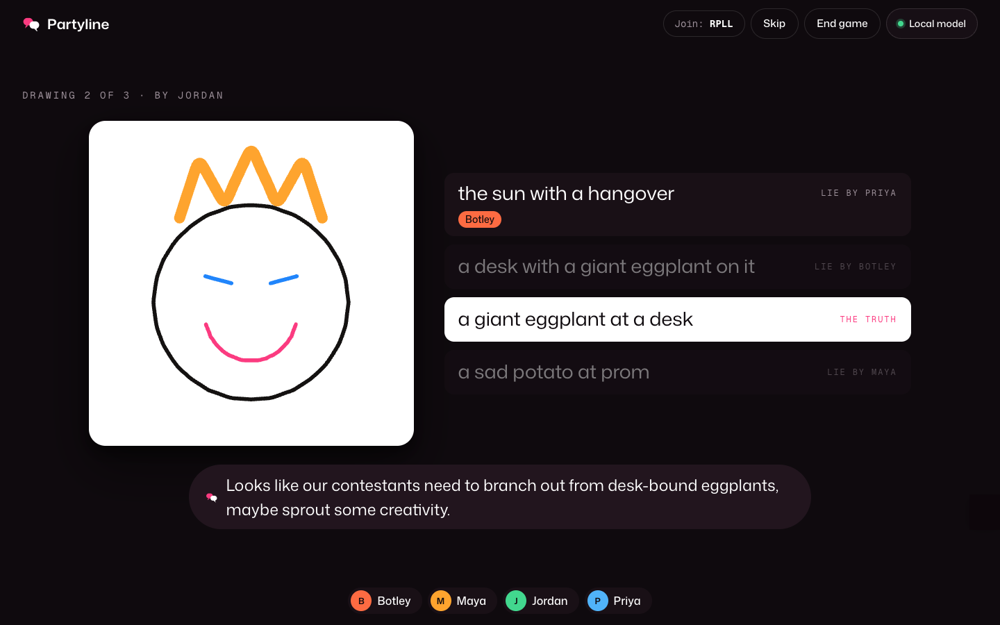

<div align="center">



# Partyline

**Party games on one laptop, friends join from their phones**

[**Live app →**](https://partyline.vedantsoni.com) &nbsp;·&nbsp; [Report a bug](https://github.com/VedSoni-dev/partyline/issues)

[](LICENSE)
[](https://partyline.vedantsoni.com)
[](https://github.com/VedSoni-dev/partyline/stargazers)

</div>



## What it does

A free alternative to Jackbox Party Packs ($24.99 to $29.99 each on Steam). One laptop or TV is the big screen; everyone
else plays on their phone.

- **Open the big screen** on a laptop, and friends join from any phone by typing a 4-letter room code or scanning a QR code. No app, no account for them.
- **Play three games:** **Comeback** (two players answer the same prompt, the room votes for the funnier one), **Fakeout** (write a lie for a weird true fact, then find the truth) and **Sketchy** (draw a secret prompt on your phone, everyone invents fake titles, guess the real one).
- **Get new prompts every round:** the AI writes them, so you never see the same one twice. A host on the big screen roasts the answers.
- **Fill an empty seat with a bot** that writes answers and votes like a player. Three players minimum, eight maximum.
- **Play remotely:** the room code works from anywhere, so share the big screen on a video call.

## Bring your own AI

No account with us. Pick what powers it, and switch any time:

| Mode | How | Works on |
|---|---|---|
| **Claude API key** | Paste your Anthropic key. Stored encrypted on your browser only. | web + your computer |
| **publik** | Sign in with publik and use your publik plan. No key. | web + your computer |
| **ChatGPT plan** | Continue with ChatGPT and use your Plus or Pro plan. No API key. | your computer |
| **Local model** | Ollama or LM Studio on your computer. Free, private, offline. | your computer |

## Run it yourself

```bash
git clone https://github.com/VedSoni-dev/partyline.git
cd partyline
npm install
npm run dev
```

In a second terminal, start the rooms server (a Cloudflare Durable Object, run locally by Wrangler):

```bash
npm run rooms
```

Open the big screen at your computer's network address, not localhost (for example `http://192.168.1.20:3000/app`), so
phones on the same Wi-Fi can reach it. Requires Node 20.9 or newer. With no AI picked, the games play from the built-in
decks.

## Screenshots

<table>
  <tr>
    <td></td>
    <td></td>
  </tr>
  <tr>
    <td></td>
    <td></td>
  </tr>
</table>

Real games, captured on 2026-11-20 with a local model. Player names are sample names.

## How it works

The game runs in the big screen's browser (`lib/engine.ts`): it holds the state, the timers and the scores, and decides
what every phone shows. Phones only send what the player did. A tiny Cloudflare Worker (`rooms/`) gives each room code
its own Durable Object, which relays messages between the big screen and the phones over websockets and keeps the last
screen each phone saw, so a refresh on either side picks up mid-round. AI calls (prompts, facts, bot answers, the
host's lines) go from the big screen through `/api/ai`; if one fails or is slow, the game uses the hand-written decks in
`lib/decks.ts`.

| Path | What |
|---|---|
| `app/route.ts`, `lib/landing.ts` | The landing page (static HTML) |
| `app/app/`, `components/Host.tsx` | The big screen (signs in with publik) |
| `app/join/`, `components/Phone.tsx` | The phone controller (no sign-in) |
| `lib/engine.ts` | The three games: rounds, timers, scoring, bots, what each phone sees |
| `lib/net.ts`, `lib/protocol.ts` | Sockets to the rooms server, and the messages |
| `lib/decks.ts` | Hand-written prompts, checked facts and drawing prompts |
| `app/api/ai/route.ts` | The AI calls (prompts live here) |
| `rooms/` | The rooms server: one Durable Object per room code |
| `kit/` | Shared studio kit: the four AI modes, the mode picker, theme and motion tokens |
| `studio.config.ts` | Name, links and which AI modes this app offers |

**Privacy.** Rooms hold only names, answers and drawings, and are deleted 6 hours after the last message. Your Claude key is kept in an encrypted, http-only cookie on your browser and sent only to Anthropic. ChatGPT sign-in tokens stay on your computer in `~/.config/partyline/` (owner-only). Local models never leave your machine. The app sends an anonymous usage count to [Vedant's builds hub](https://builds.vedantsoni.com) (this app's name, which AI mode answered, a random id per browser; no content, no IP, no account), and never for browsers with Do Not Track or Global Privacy Control.

## Credit

Partyline's games are inspired by how Jackbox Party Packs play. Its games, prompts, names and look are its own, and it
isn't affiliated with Jackbox Games.

## Contributing

Issues and pull requests are welcome. For a bigger change, open an issue first so we can talk about it.

## License

[MIT](LICENSE) © Vedant Soni

<div align="center">
<sub>Built in public by <a href="https://instagram.com/vedanttalksai">@vedanttalksai</a>. More builds at <a href="https://vedantsoni.com">vedantsoni.com</a>.</sub>
</div>
